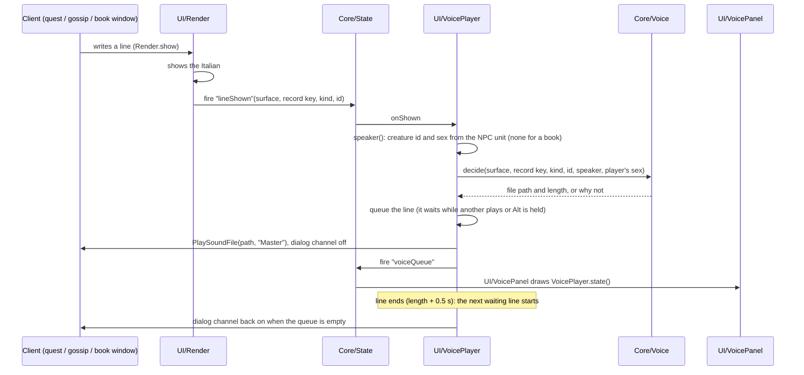

# Voice over

> Italian voices for the NPCs: a quest offer, progress or turn-in, an NPC's greeting, a book or letter page is read aloud, in the Italian the addon ships, by a voice cast for whoever says it. A small panel beside the window shows the speaker's 3D head, name, a stop and a skip button. The audio lives in a separate addon folder (`OldpZ_ForeverITA_Voce`); the main addon holds the player and the panel and plays nothing without it. Code: `Core/Voice.lua`, `Core/VoiceQueue.lua`, `UI/VoicePlayer.lua`, `UI/VoicePanel.lua`, `UI/VoicePanelHead.lua`, `UI/VoiceQuestLog.lua`, the `OldpZ_ForeverITA_RegisterVoice` global in `Main.lua`, the `voice.*` settings, `pipeline/wfj/cmd/voice.py` (and `voice_cast.py`, `voice_scope.py`, `voice_make.py`, `voice_spoken.py`, `voice_audition.py`, `voice_ship.py`), `pipeline/wfj/core/voice.py`, `pipeline/wfj/core/casting.py`, `pipeline/wfj/io/gemini.py`, `pipeline/wfj/emit/voice_pack.py`, `pipeline/voice.toml`, `pipeline/voice_tirisfal.txt`, `data/voice/`. Decision: [ADR-104](../adr/104-voce-italiana-con-gemini.md). Runbook: [Voice over](../operations/voice.md).

## Purpose
A guild member takes a quest in Tirisfal Glades, hears the NPC in a voice that fits it (race, sex, age, character), always the same voice for that NPC, sees its portrait talk in a small panel, and can stop or skip the line. What is heard is what is read: the audio is made from the Italian the addon ships, and each file carries the hash of that Italian, so a line whose translation changed after the recording stays silent until it is made again.

The audio is made on the maintainer's computer with Google Gemini TTS (`gemini-3.1-flash-tts-preview`), kept outside the repository, and shipped as a separate pack beside the main addon. A player without the pack sees no voice setting, no frame and no button, and the addon behaves as it did before the voice existed.

The first scope is the undead starting area (Deathknell and Tirisfal Glades): every quest there, the greetings of the NPCs who give and take them, and the books and signs standing there.

## How it works


### What is voiced
| Window | Record | Pack key | Setting |
|---|---|---|---|
| Quest window, offer | `description` | `<quest id>-description` | `voice.offer` |
| Quest window, progress | `progress` | `<quest id>-progress` | `voice.progress` |
| Quest window, turn-in | `completion` | `<quest id>-completion` | `voice.turnin` |
| Quest window, NPC greeting panel | `greeting` | `g-<gossip key>` | `voice.greeting` |
| NPC talk window, greeting | `greeting` | `g-<gossip key>` | `voice.greeting` |
| Book, letter or plaque page | `page` | `b-<page key>` | `voice.books` |

`Voice.KINDS` holds this table. Objectives, quest titles, clickable options, shouts and chat lines are never voiced, and neither are the character's own error lines.

### Who speaks
`wfj voice speakers` writes `data/voice/speakers.jsonl`: for each line of the scope, its main speaker (a creature id, `narrator` or `book-narrator`) and the `others` who say it too.

- The offer is read by the creature that starts the quest, progress and turn-in by the one that ends it (VMaNGOS). A quest the open database lacks (one Forever added) takes the creature most players' captures saw in the window (forever-vo). A quest started by an object or an item, with no creature, is read by the narrator.
- A gossip line is read by the creature whose greeting it is. A creature id the collector recorded in game for that line wins over the database.
- A book page is read by its signer when exactly one creature that speaks has that name (the page's last line is a name, `book_signature`), otherwise by the book narrator.
- Two creatures for one line: the lowest id is the main speaker, the rest go into `others`; each may have a voice of its own.

### The scope
A scope is a list of ids in `pipeline/voice_<scope>.txt`, written by `wfj voice scope` and committed: the database's quests of the zone's areas plus Forever's own quests whose captured giver stands inside the zone's map bounds, and `b <key>` for each page of a sign or book standing there. What cannot be placed (no giver captured, given by an object, given by a creature the database never spawns) is counted and left out, never guessed. Only the `tirisfal` scope exists.

### What the voice reads (`core/voice.speech_text`)
The text sent to the engine is the shipped Italian, for a player of one sex:

- A marked name (`⟦en=it⟧`) is read in its Italian form, as the player sees it with `names.style = it`.
- `{name}` is read **eroe** (male character) or **eroina** (female). The player's name is never in the audio.
- A `<a/b>` pair is read as `a` for a male character and `b` for a female one.
- `$B` is a line break, `$N<k>` the k-th number of the line's English, as the addon fills it from the live text; a number only the game knows (`$<n>w`, or one missing) is read "alcuni".
- Stage directions (`<Trevan sorride.>`), colour codes, `%s` and page markup (``, `<P>`) are dropped. A line that is nothing but a stage direction is read without its brackets.
- `{class}` and `{race}` are never filled with the player's class or race: a line that has them is read only from a **spoken version** (below). Without one it stays silent.
- Any other markup would be read as symbols: the line is refused with its key and not sent.

A line said differently for each sex (`{name}` or a `<a/b>` pair, in the written Italian or in its spoken version) is made twice: `<key>.mp3` for a male character and `<key>_f.mp3` for a female one.

### Spoken versions
A line cannot always be said as written: it names the player's class or race (a fixed word would break the grammar), or the safety filter blocked every take of it. Its **spoken version** says the same thing, lightly reworded, and is the one deliberate exception to "what is heard is what is read". It is kept in `data/voice/spoken.jsonl` per line and sex (`m`, `f`, or `any` for one both sexes hear) beside the hash of the written Italian, with a reason and a provenance. `wfj voice spoken export` lists the lines that need one; `import` checks every row (a line of a scope, Italian unchanged since the export, a text the voice can read for each sex, English tags only) and writes none if one row is bad. A spoken version made from other Italian is stale and never read; the owner hears the spoken versions at the audition.

### The prompt (`io/gemini.prompt_text`, `cmd/voice_make.build_prompt`)
One take is one `generateContent` call. The prompt has three sections, `# AUDIO PROFILE:` (who speaks: the creature's English name and its profile fields), `### DIRECTOR'S NOTES` (the roster voice's notes) and `#### TRANSCRIPT` (the speech text). Direction is English only, because Gemini reads direction it does not take for English aloud: the audio profile and the notes are refused when they carry an accented letter or a common Italian word (`casting.not_english`). The transcript is Italian with English tags only. The tags allowed are the `SPEECH_TAGS` of `core/voice.py`: `[sigh]`, `[laughing]`, `[whispering]`, `[cough]`, `[shouting]`, `[crying]`, `[gasp]` and `[groan]`; any other bracket would be read aloud, and the line is refused. There is no `systemInstruction`: the direction travels in the text.

### Casting
`data/voice/profiles.jsonl` says who each speaking creature is: race (or creature family), gender (`male`, `female`, `none`, `mixed`), age, archetype and role. Each field carries its provenance, in this order of trust: a ruling of the maintainer, the client's display tables, VMaNGOS, the casting pass (a machine judgement for what the tables do not say, age above all). A value from a higher source is never replaced by a lower one.

`pipeline/voice.toml` holds the **roster** (a voice id, the Gemini prebuilt voice, the director's notes, what it is for) and the **cast rows**, first match wins, each with a `when` (profile fields) and a list of `voices`. A creature gets one voice from its row's list, chosen by a stable hash of its id: the same creature always gets the same voice, and neighbours spread over the list. `data/voice/overrides.jsonl` names a voice for one creature and wins over the rows. A creature the game shows as both sexes (`mixed`) is cast twice, male and female, and the addon picks by the NPC on screen. No match falls to the narrator. `wfj voice cast` writes `data/voice/voices.jsonl`.

### The engine (`io/gemini.py`)
`POST https://generativelanguage.googleapis.com/v1beta/models/<model>:generateContent` with the key in the `x-goog-api-key` header, read from `GEMINI_API_KEY` or from a `.env` file (`--env-file`). The key is never part of a URL, a message, a log or a repr. The audio comes back as base64 PCM s16le, mono, 24 kHz, and is wrapped as a WAV.

- A take the safety filter stops (`finishReason` `SAFETY`, `PROHIBITED_CONTENT`, `BLOCKLIST`, `SPII`, `IMAGE_SAFETY`, or no audio) raises `Blocked`. The filter is random: the same line often passes on another try. `synthesize_retry` asks again up to four takes in all, then raises `Blocked`.
- HTTP 429 and 503 raise `Busy`: the engine waits 5, 15, 45 and 120 seconds in turn without using up a take, then raises `Busy` and the run stops.
- Any other failure raises `EngineError` and stops the run.

### Making the audio (`cmd/voice_make.py`)
`plan` lists what `generate` would make now, without calling the engine: files missing, files whose Italian, spoken version, voice, notes or profile changed, files gone from the store, by voice, with characters, hours of audio and an estimated cost, and the **silent lines** by reason (no voice cast, no spoken version, a stale spoken version, a line the voice cannot read). `generate` makes them.

- **The store** is a folder outside the repository (`VOICE_ROOT`, or `--store`). `wav/` keeps each paid take as the engine returned it, with the fingerprint it was made for; `mp3/` holds what the pack ships; `blocked.jsonl` lists the takes the filter blocked four times; `status.json` is the run's progress.
- **The MP3** is encoded with `lame -m m --resample 22.05 -b 32 --cbr -t --quiet`: mono, 22.05 kHz, 32 kbps CBR, **without the Xing / Info header** (with it the client cuts the line short). The duration is measured on the WAV.
- **The record** `data/voice/audio.jsonl` gets one row per made file (key, voice, sex, Italian hash, fingerprint, seconds, bytes, SHA-256, provenance), written after every file.
- **The fingerprint** (`voice.fingerprint`) is the hash of what the take was made from: the Italian with its numbers and spoken version, the roster voice, the Gemini voice and model, the notes, the player's sex and the audio profile. Change any of them and only the files that depended on it are made again; recasting one kind of speaker remakes only its lines.
- **Resume**: a stopped run starts again from the record. A paid take whose MP3 or record row was never written (the encoder failed, the process died) is encoded again from its kept WAV, not asked of the engine again. A take blocked four times is not asked again until its line, spoken version, voice or profile changes.
- **A busy or failing engine, a missing `lame`, or an unreadable take stops the run** and says how many files are left; running it again resumes. A blocked take only goes on the list and the run goes on.

### The pack (`cmd/voice_ship.py`, `emit/voice_pack.py`)
`wfj voice pack` writes `build/voice-pack/OldpZ_ForeverITA_Voce/` and the zip `OldpZ_ForeverITA_Voce-<version>.zip`:

```
OldpZ_ForeverITA_Voce/
  OldpZ_ForeverITA_Voce.toc   ## Dependencies: OldpZ_ForeverITA; the main addon's icon
  Register.lua                one call: OldpZ_ForeverITA_RegisterVoice({ format = 3, folder = "…", lines = { … }, creatures = { … } })
  Sound/<file>.mp3            one file per line, per sex and per voice
  LEGGIMI.txt                 what it holds and the credits
```

Format 3: each `lines` entry is `[<pack key>] = { <file>, <Italian hash>, <seconds>, f = { <file>, <seconds> }, v = { [<voice id>] = { <file>, <seconds>, f = { … } } } }`. `f` is the take for a female character, `v` is there only for a line several differently cast creatures say, and `creatures` maps each speaker of such a line to its voice id (`{ m = …, f = … }` for a creature shown as both sexes). The Italian hash is `hashing.key` over the Italian exactly as the addon ships it, markers and placeholders intact; the addon computes `Hash.key` over the same raw text (`Lookup.raw`, no `Names`), so the match does not depend on `names.style` or on the player.

The pack ships only the takes whose recorded fingerprint is the current one and whose MP3 in the store is exactly the recorded file (size and SHA-256); the others are left out and listed by reason (blocked, missing, stale, damaged). It is refused, writing nothing, over 420 MB (CurseForge refuses an upload over about 500 MB). The zip is checked to hold nothing `Register.lua` does not list.

### Registration (`Core/Voice.lua`, `Main.lua`)
The pack's `Register.lua` runs in its own addon, so it cannot see the main addon's namespace; it calls the global `OldpZ_ForeverITA_RegisterVoice`, which `Main.lua` defines before any pack loads (the pack depends on the main addon). `Voice.register` accepts format 3 and a folder name that starts with `OldpZ_ForeverITA_Voce`; it checks each entry's shape (a file name `^[%w%-_]+%.mp3$`, a 16-hex hash, numbers for lengths) and drops and counts the malformed ones. A file name outside the pack's `Sound` folder would play another addon's file, so none is built from anything else. Packs merge: each line remembers its folder, and a pack that registers again replaces only what it brought. A pack that brought at least one line fires State `voicePack`: the settings get their **Voce** page and the quest log its button.

### The decision (`Voice.decide`)
`decide(surface, record key, kind, id, speaker, sex, peek)` returns a file and its length, or nil and a reason:

| Reason | Meaning |
|---|---|
| `kind` | the surface and record are not voiced |
| `off` | `voice.enabled` or the kind's setting is off, or a greeting set to once for a creature already heard |
| `english` | translation is off |
| `nopack` | no pack has registered |
| `missing` | the pack has no entry for the line |
| `notext` | the addon ships no Italian for it |
| `stale` | the hash of the shipped Italian is not the entry's: the translation changed |
| `nofemale` | the player is female, the line's words need a female take and the pack has none |

A female character never hears the male take of a line that names the player or picks a word by sex. The take is the one of the speaker's voice when the line has one for it, else the line's main take. `decide` only reads; the player calls `Voice.markHeard` when a greeting starts playing. `peek` asks without counting and ignores the greeting memory (the quest log's button).

### Playing (`UI/VoicePlayer.lua`)
- The start is State `lineShown`, fired by `UI/Render` after a write the client asked for, never on a refresh. The speaker is the creature of `questnpc` (quest window) or `npc` (talk window), with its sex; a book has none.
- A line shown while another plays waits in `Core/VoiceQueue`; the same key is never queued twice (the talk window lays its first page out twice). The next line starts when the one before it ends.
- `PlaySoundFile(path, "Master")`. The client reports no end, so a line ends at the pack's length plus 0.5 seconds (30 seconds when the entry has no length), on a timer carrying a token: an old timer never closes a newer line.
- **Alt (the reveal key) never stops a line that is playing**: a player holds it to compare the English while listening. While it is held no line starts; a line shown then, or the next in the queue, waits and starts when the key is let go.
- **Stops** that empty the queue: the stop button, `/fita voce stop`, translation or the voice setting switched off, a loading screen, logout. **Skip** starts the next waiting line now. Closing the window stops nothing: the line plays to its end.
- **The game's English voice**: while a line plays `Sound_EnableDialog` is turned off, only if it was on and `voice.muteDialog` is on. The fact is kept in `OFI_DB.voiceDialogMuted`, because the client saves the setting to `Config.wtf` and a crash in between would leave the player's NPC voices off for good; it is put back when the queue runs out, on stop, at logout and on the next load. A player who had the channel off keeps it off, and one who turned it on by hand while the line played keeps what they chose.
- A greeting set to once per creature is remembered in `OFI_DB.voiceHeard[creature id]` when it starts playing, not when it is queued. A file the client refuses is dropped and the next one plays.
- Without a pack `onShown` returns at once: no frame, no sound call.

### The panel (`UI/VoicePanel.lua`, `UI/VoicePanelHead.lua`)
A small frame, `WFJVoicePanel`, about 220 × 64, a child of `UIParent` and never of a Blizzard frame, built by the first line that plays. Its `TOPLEFT` is anchored 4 pixels right of the `TOPRIGHT` of the quest, talk or book window that showed the line. It holds the speaker's 3D head, its name (Italian from `UnitNames` when `names.style = it` and the unit's name ships, otherwise the client's; a book's own title for a page), a stop button, a skip button and "+N" while N lines wait. No text: the window already shows it.

The head is loaded from the NPC's unit (`SetUnit`) while the unit is still the line's speaker, otherwise from its creature id (`SetCreature`); the talking animation plays while the line does. A book, a narrator line or a creature the client cannot show gets an icon of the client's own art. A window that closes leaves the panel where it was; once nothing plays it goes after 3 seconds; the stop button hides it at once.

### The quest log button (`UI/VoiceQuestLog.lua`)
The addon remembers who spoke each quest field the window showed (`OFI_DB.voiceSpeakers["<id>-<field>"]`, kept only with a pack). In the quest log's details a play button appears on a quest whose description has a file; a click queues it like an offer, with the head and name remembered. The hook on `QuestMapFrame_ShowQuestDetails` is installed only when the pack arrives.

### Settings and diagnostics
The **Voce** page exists only once a pack has registered: `voice.enabled`, one switch per kind (`voice.offer`, `voice.progress`, `voice.turnin`, `voice.books`), `voice.greeting` (once per creature, always, never; default once), `voice.muteDialog`. `/fita voce stop` stops the line and empties the queue (with no pack it says so). `/fita debug` prints `voice: no pack` or the pack folder, its lines, registered, invalid, matched, missing and stale counts, the queue and the played and refused counts.

## Key files
| File | What it holds |
|---|---|
| `pipeline/wfj/core/voice.py` | speech text rules, `SPEECH_TAGS`, the fingerprint, who speaks a line, speaker validation |
| `pipeline/wfj/core/casting.py` | profile fields and their provenance, roster and cast rules, the English-only check |
| `pipeline/wfj/io/gemini.py` | the Gemini engine, retries and backoff, `Blocked` and `Busy` |
| `pipeline/wfj/cmd/voice.py` | the `speakers` verb and the dispatch of the others |
| `pipeline/wfj/cmd/voice_scope.py` | the scope list of a zone |
| `pipeline/wfj/cmd/voice_cast.py` | `profiles build / export / import`, `cast` |
| `pipeline/wfj/cmd/voice_make.py` | `plan`, `generate`, `status`, the store, the record, the blocked list |
| `pipeline/wfj/cmd/voice_spoken.py` | spoken versions: `export`, `import` |
| `pipeline/wfj/cmd/voice_audition.py` | the audition page |
| `pipeline/wfj/cmd/voice_ship.py`, `emit/voice_pack.py` | the pack folder and zip |
| `pipeline/voice.toml`, `pipeline/voice_tirisfal.txt` | the roster and cast rows, the scope |
| `data/voice/` | `speakers`, `profiles`, `voices`, `overrides`, `spoken`, `audio` (JSONL) |
| `addon/OldpZ_ForeverITA/Core/Voice.lua`, `Core/VoiceQueue.lua` | the registry, the decision, the order |
| `addon/OldpZ_ForeverITA/UI/VoicePlayer.lua`, `VoicePanel.lua`, `VoicePanelHead.lua`, `VoiceQuestLog.lua` | playing, the panel, the head, the quest log button |

## Invariants
- Without a registered pack: no voice frame, no setting shown, no hook that changes behaviour, nothing written to `OFI_DB` but the dialog-restore flag when it is set.
- A file plays only when its hash is the hash of the Italian the addon ships now. A changed translation silences the line until the audio is made again.
- The player's name, class and race are never in the audio: `{name}` is eroe / eroina, `{class}` and `{race}` only through a spoken version.
- A female character never hears a male take of a line that names the player or picks a word by sex.
- The same creature has the same voice every time.
- Direction (audio profile and notes) is English only and the transcript carries only the `SPEECH_TAGS`; a prompt that breaks either is never sent.
- The API key is never in a URL, a log, a message or the repository; the audio store is outside the repository.
- Only post-hooks and our own frames: no Blizzard frame is written, no protected function replaced (no taint).
- The MP3 is mono, 22.05 kHz, 32 kbps CBR, without a Xing header; the pack stays under 420 MB.

## Edge cases
- **The filter blocks a line**: after four takes it goes to `blocked.jsonl` and is not asked again until its line, voice or profile changes; it is silent until it has a spoken version.
- **The engine is busy** (429, 503) in the evening: the run waits, then stops with the number of files left; run it again.
- **A creature has no voice** (not profiled or cast): its lines are silent and listed by `plan`.
- **A creature with no profile fact** falls to the narrator row.
- **A gossip line said by several creatures with different voices**: the speaker on screen picks its voice's file; a creature the pack does not know plays the main take.
- **A creature shown as both sexes**: the NPC's own sex picks the male or the female voice.
- **A quest started by an object**: the narrator reads the offer; the turn-in is read by the creature that ends it.
- **A book page with no signer, or a name no speaker has**: the book narrator.
- **A greeting heard once** is not asked again for that creature unless the setting is "always"; the quest log button ignores that.
- **Two packs** registering lines for the same key: the later one wins and replaces only what it brought.
- **A client that refuses a file**: counted as refused in `/fita debug`, the next line plays.
- **A page the client lays out twice** queues once.

## Unverified in game
These facts come from the code and the stubs, not from a run in the Forever client; the in-game check is [Testing → Voice over](../testing/strategy.md).

- `PlaySoundFile(path, "Master")` returns `willPlay, handle`, `StopSound(handle)` stops the file, and the length plus 0.5 seconds does not cut the end.
- `Sound_EnableDialog` set through `C_CVar` silences the NPCs' English voices and comes back after `/reload` and logout.
- The panel beside the quest, talk and book windows: position, overlap, strata, the look of the backdrop, and no "action blocked" in combat.
- The 3D head: `SetUnit("questnpc")` and `SetUnit("npc")`, `SetCreature(id)` after `/reload`, zoom and camera, the talking animation 60 moving the mouth, and the book icon `INV_Misc_Book_09` and the next-page arrow existing.
- The quest log button: its place on the details frame, and `QuestMapFrame_ShowQuestDetails` being hookable after login (the pack registers after the main addon loaded).
- The loading screen event `LOADING_SCREEN_ENABLED` firing on a portal or a hearthstone and stopping the line.
- The **Voce** page appearing in the options panel when added after the categories were registered.
- `UnitSex` on `questnpc` and `npc`, for the voice of a creature shown as both sexes.
- That a line shown while Alt is held, in a window that stayed English, is not played in Italian by mistake (the hash binds the audio to the Italian text, not to what the window shows).
- Gemini's side: how many lines the filter blocks, whether a creature's voice stays coherent from line to line, and whether the direction is followed. Measured at the audition and in the pilot.

## Related
- [ADR-104](../adr/104-voce-italiana-con-gemini.md) · [Voice over runbook](../operations/voice.md) · [Settings](settings.md) · [Pipeline](pipeline.md) · [Collector](collector.md) · [Addon modules](../architecture/addon-modules.md) · [Data model](../architecture/data-model.md)
